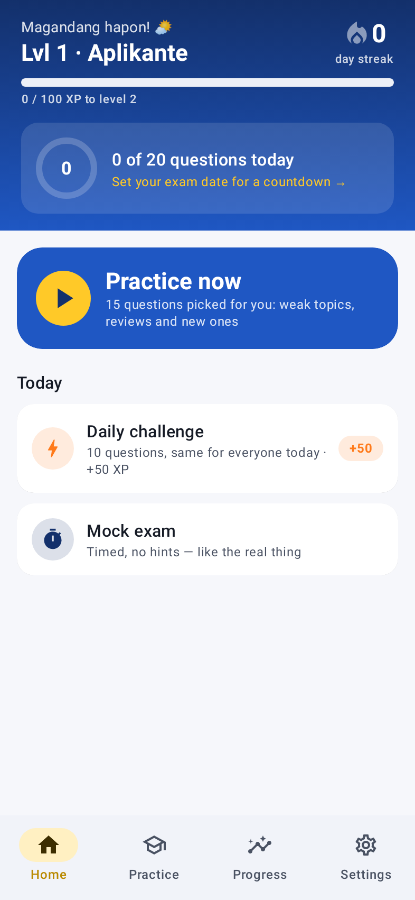
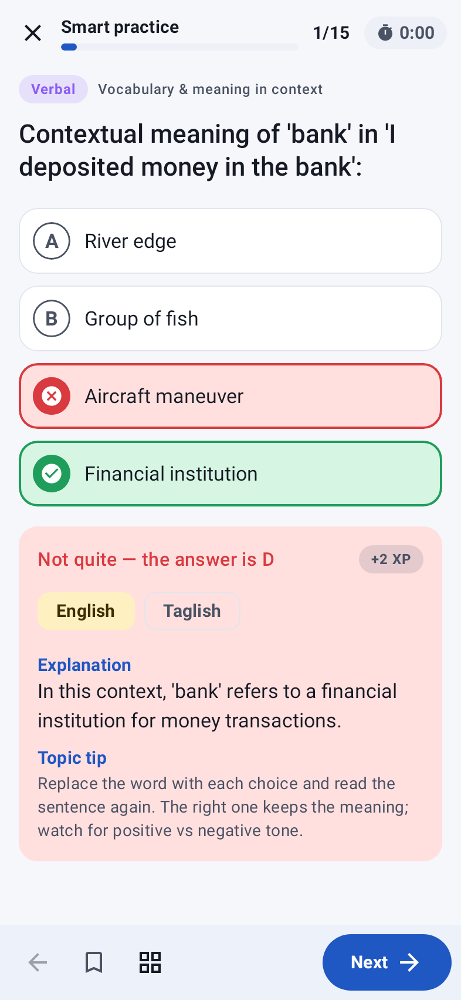
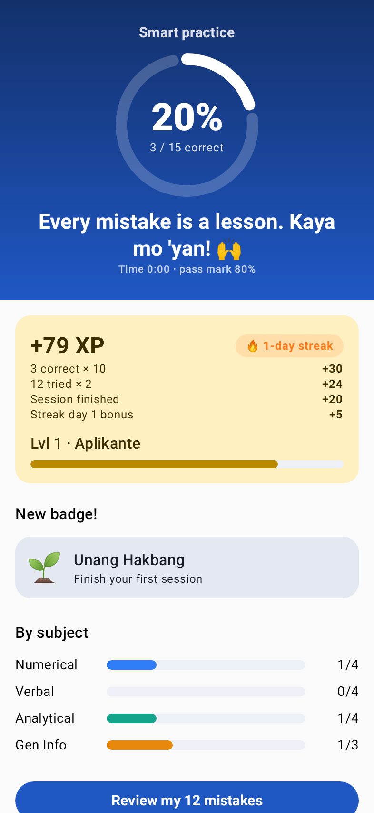
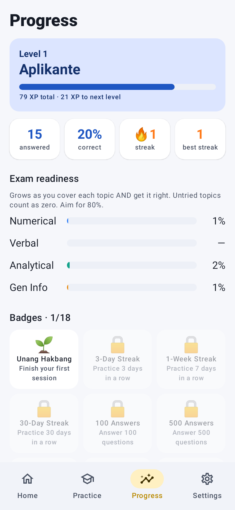

# CSE Practice

An offline Android reviewer for the Philippine Civil Service Exam (CSE). The app is built to be fun to use, and it adapts to each user by following their own answers. It needs no internet and makes no AI calls on the phone.

| Home | Question + feedback | Results | Progress |
|---|---|---|---|
|  |  |  |  |

## What it does

- **Practice now**: one tap starts 15 questions picked for you. The mix is about 40% missed questions that are due again, 40% from your weakest topics, and the rest new questions balanced across the 4 subjects.
- **Daily challenge**: 10 questions, the same for everyone that day, worth +50 XP.
- **Exam mode**: a mini mock (40 items in 40 minutes) or a long mock (100 items in 100 minutes). The clock counts down and there are no hints. Answers are shown only after you submit.
- **Topic drills**: 31 topics across Numerical, Verbal, Analytical and General Information, each with a study tip in English and Taglish.
- **Feedback after every answer**: a worked solution, why your choice is wrong, and a topic tip. Each one can be switched between English and Taglish.
- **Spaced repetition**: a missed question comes back the next day, then after 3, 7 and 14 days, until you have it.
- **Gamification**: XP, levels ("Aplikante" up to "CSE Master"), a daily streak, 18 badges, a daily goal ring, and an exam-day countdown.
- **Readiness per subject**: grows only when you cover a topic and also get it right. Topics you haven't tried count as zero.
- **Resume**: Back, switching apps, or Android killing the app never loses a session. It shows up as "Continue" on Home.

Navigation is 4 bottom tabs: **Home · Practice · Progress · Settings**. Back always works the same way: overlay, then sub-page, then Home, then exit. A session asks before you leave it.

## Content pipeline (Python, run with the PyCharm ▶ button)

```
content/source_questions.json    original bank (1,169 items)
content/authored_items.json      hand-written items: reading passages, Filipino, Constitution, RA 6713, rights, environment
content/topics.json              31 topics + English/Taglish tips
content/ai_content.json          (optional) Claude-written explanations, from tools/generate_ai_content.py
        │
        ▼  tools/build_content.py
app/src/main/assets/questions.json + topics.json      (shipped in the app)
```

- `tools/build_content.py` drops broken items, fixes known errors, and tags subtopics. It also writes rule-based worked solutions in English and Taglish for templated math, checks every rule against the answer key, and prints a coverage report.
- `tools/generate_ai_content.py` fills in the explanations, hints, why-wrong notes and Taglish that are still missing. It calls Claude on Steve's API key once, at dev time. `MOCK_MODE = True` by default (no key, no cost). Claude also checks each answer key. Any item where it disagrees is **not** merged and is listed for a human to review.
- `tools/tutor_server.py` is a stub for the optional online "Ask the tutor". It is off in the app (`TUTOR_ENABLED = false` in `app/build.gradle.kts`) and has no INTERNET permission.

After editing content, run `build_content.py` and bump `QUESTIONS_VERSION` in `QuestionRepository.kt`.

## Build & test

```bash
./gradlew :app:assembleBeta          # small tester APK (R8, debug-signed) -> app/build/outputs/apk/beta/
./gradlew :app:assembleDebug
./gradlew :app:testDebugUnitTest     # logic tests + full-app Robolectric run, screenshots -> app/build/outputs/roborazzi/
```

Needs JDK 17+ (the Android Studio JBR works). Stack: Kotlin, Jetpack Compose (Material 3), Room, DataStore, Vico, Gson.

## Known limits

- Taglish and step-by-step solutions currently cover the 462 templated math items and the 54 authored items. The rest show English plus the topic tip until `generate_ai_content.py` is run with real credits.
- General Information still has about 127 world-trivia items that are outside the CSE scope. They are tagged "General knowledge (extra)" and kept out of smart practice, the daily challenge and exam mode.
- `beta` APKs are signed with the debug key and are for testers only. A real release key is needed before the Play Store.

Inspired by Pearl Jynne Celestino · PJC Inc
